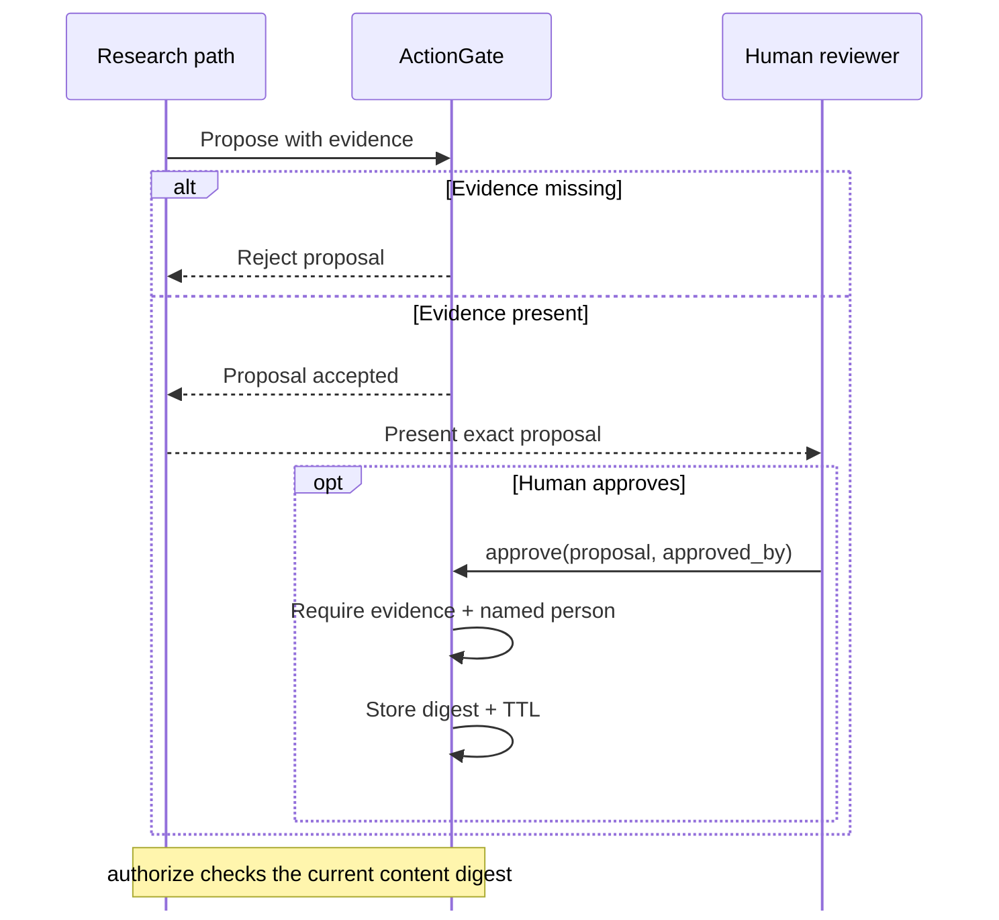

# Human-Gated Research

Here's a bad idea: a person approves a research agent's proposal, the agent changes the target, then sends it anyway because **the approval ID is still valid**.

This Python project exists to make that particular trick fail.

The thing being approved isn't just an ID. It's a digest of the **claim, action, target, rationale, and evidence** (plus the proposal identity). Change the proposal and the old approval stops matching. Approvals also expire and can't be reused for a second consequential action.

## A tiny thought experiment

1. Research finds evidence for a claim and prepares a proposal.
2. A reviewer approves that *exact version*.
3. Someone changes the recipient or evidence.
4. The gate refuses: `proposal_changed_after_approval`.

Even without tampering, `no_approval`, `approval_expired`, and `already_acted` stop the action when appropriate. Read-only work can proceed without approval.

For evidence ranking, the library counts independent source **groups**, not how many times the same article got reposted. Ten copies of one source are still one source wearing ten hats.

## The approval has to survive two checks

Approval is tied to the proposal the reviewer actually saw.

At the action boundary, the gate checks the approval against the **current** proposal. Changed contents, expiry, or a previously used approval block a consequential action. Read-only work remains a separate path.

The [test map](docs/verification.md) covers missing evidence, read-only behavior, expired approvals, replay, content mutation, and the one-use allowance.

The code: [proposal model](src/research_gate/proposal.py), [canonical digest](src/research_gate/digest.py), [the gate](src/research_gate/gate.py), [source-group handling](src/research_gate/evidence.py).

## Important catch

These approvals live **in memory**, and `approved_by` is just a supplied name. It is not identity authentication. There is no browser, payment method, email transport, or production authorization service here.

That's a small, testable rule for a bigger application to build around, not permission to send real things. [Security notes](SECURITY.md) · [provenance](PROVENANCE.md).
